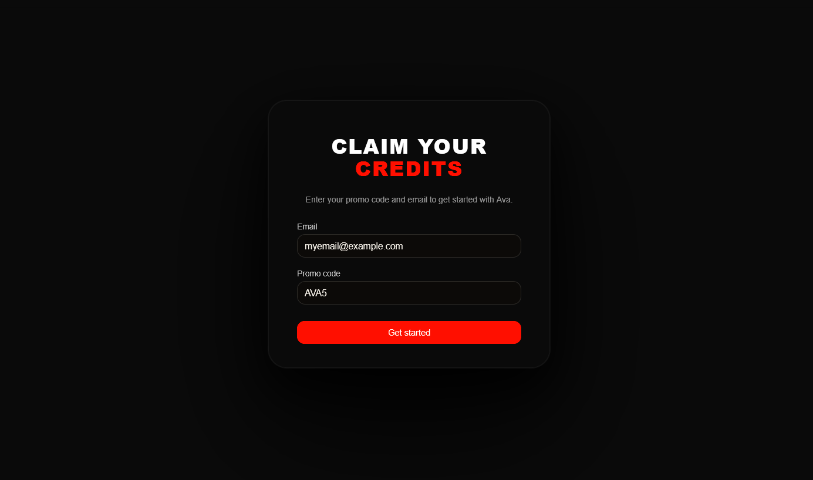
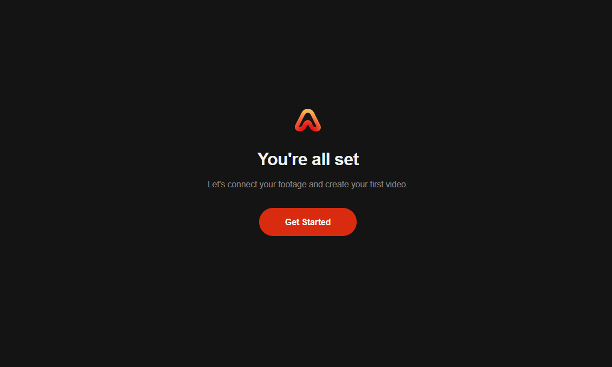
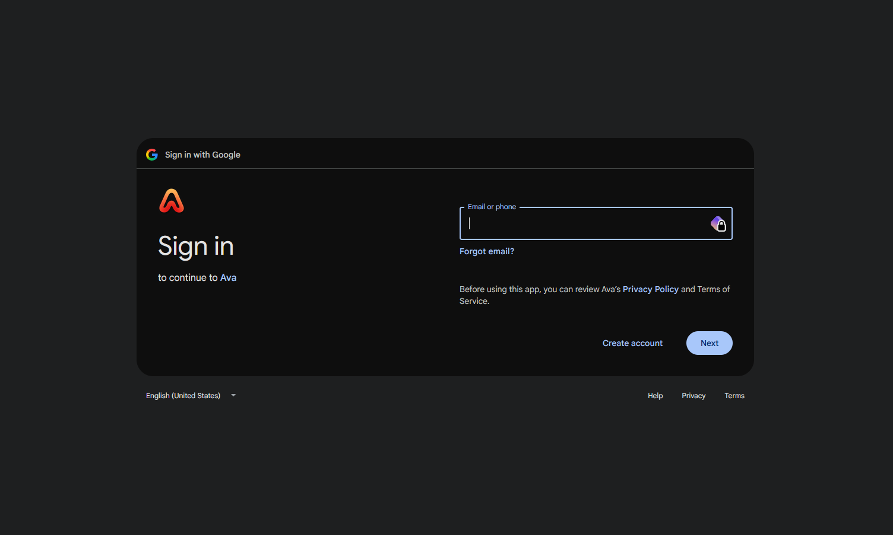
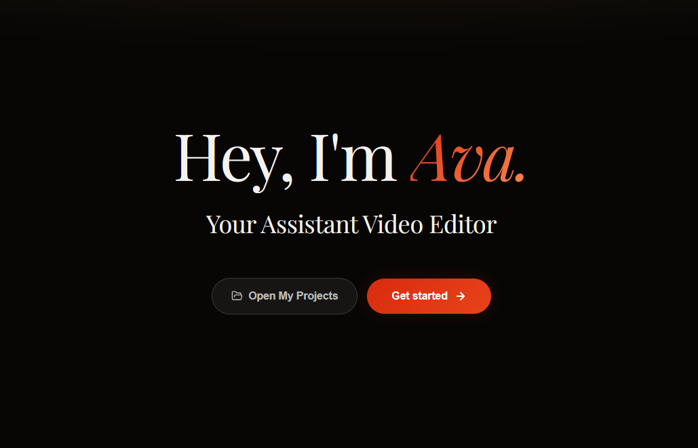

Source URL: https://hackapertus.notion.site/3de3bdc93da0801d8934df4d9c8efd42
Fetch date: 2026-10-12

# Getting Free Credits for EditWithAva

**What is Ava?**

Give your raw footage to Ava, including b-roll, voiceover files and you talking into the camera and Ava can edit it into a finished video under your guidance. You can either describe the script you want, provide a full shot list or let Ava come up with a good video by herself.

**How to sign up and redeem the credits**

1. Go to [https://editwithava.com/promo](https://editwithava.com/promo)

1. Enter your personal email address and the promo code **AVA5**

size: 39.7 KiB

1. Click the confirmation link in the email you received

1. Fill out the short onboarding survey

size: 16.8 KiB

1. Link your Google Account (this is how you’ll be able to log in again)

size: 46.6 KiB

1. Start editing by clicking “**Get Started**”

size: 45.4 KiB

**Note**: Ava will take some time to both analyze your footage and to finish the actual edit. Depending on the size of your pool this can take 20-60 minutes, but you’ll receive an email once Ava is done with a video.
