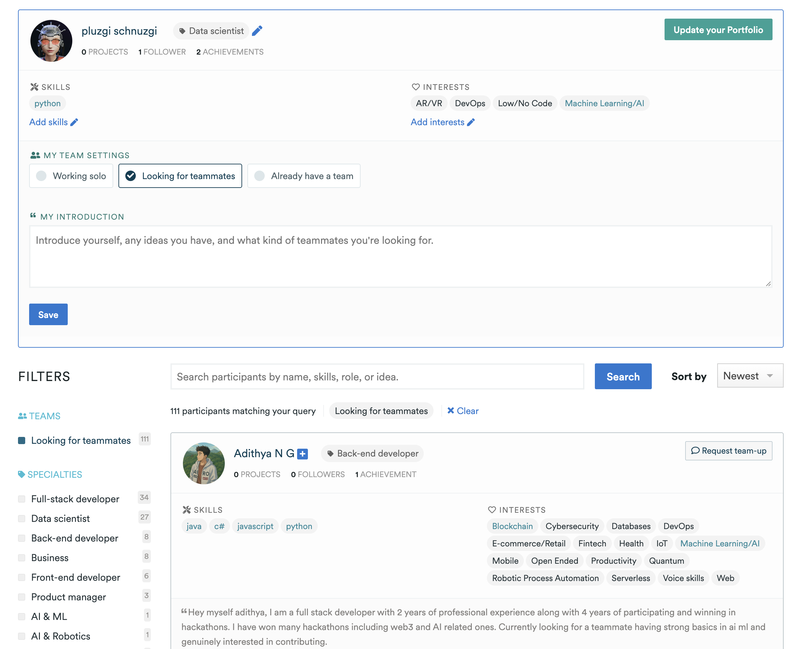
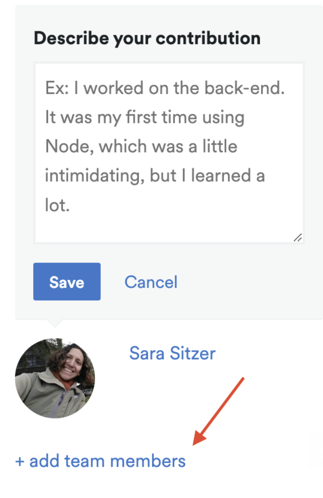
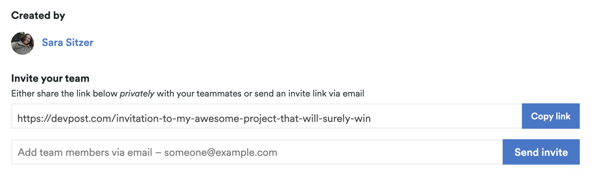

Source URL: https://hackapertus.notion.site/21eb4fec112a8298b29e81c636999ff5
Fetch date: 2026-10-12

# How to team up

You have at least 2 options to team up:

→ [Devpost](https://hackapertus.devpost.com/participants)
General information is available here: [https://help.devpost.com/article/75-participants-page-forming-a-team](https://help.devpost.com/article/75-participants-page-forming-a-team)
Projects can be created starting 1. OCT, 12:00 CEST.

Option A) Check the participants tab and filter for “Looking for teammates”

Check profiles of other participants and if it’s a fit, click the “Request team-up” button shown on their profile (an automated email will be sent)

size: 523.9 KiB

Option B) Once someone starts a draft project, they can then add other persons to their project. They'd go to their project page and click **+ add team members**.

size: 165.3 KiB

This will take you to the **Edit your project** page, where you can either copy the invitation link to send to your teammate or simply insert your email to have the invitation sent directly from Devpost.

size: 160.7 KiB

### → [Discord](https://discord.gg/hack-apertus)

→ In #channels & roles pick the right ones for your profile
→ Check the **#👥┃team-formation** channel and shortly introduce yourself, also explain what type of people/team you are looking for. (Look at past messages as an inspiration for how to write this short message)

You can work solo but it’s less fun.;-)
