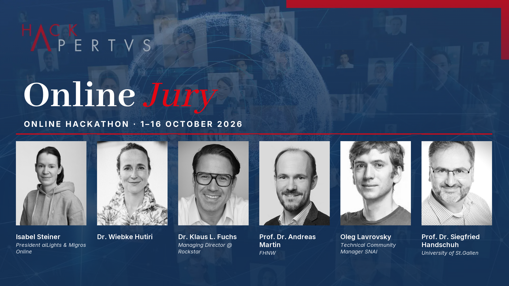

Source URL: https://hackapertus.notion.site/adeb4fec112a82d58cbc8131e21ca274
Fetch date: 2026-10-12

# Jury & Awards

size: 1.5 MiB

#### **🏋🏼‍♀️Awards**

##### **🏆 Winner Red-Teaming - CHF 2,500**

→ Qualifies to compete for the Main «Hack Apertus» Award (St.Gallen, 14.05.2027)
→ $200 Hugging Face credits

##### **🥈 1st Runner-up Red-Teaming**

→ $ 100 Hugging Face credits
→ A certificate + dedicated LinkedIn post

##### **🥉 2nd Runner-up Red-Teaming**

→ $ 50 Hugging Face credits
→ A certificate + dedicated LinkedIn post

##### **🏆 Winner Swiss Voices – CHF 2,500**

→ Qualifies to compete for the Main «Hack Apertus» Award (St.Gallen, 14.05.2027)
→ $200 Hugging Face credits

##### **🥈 1st Runner-up Swiss Voices**

→ A Showcase spot at the Grand Finals (14.05.2027)
→ $ 100 Hugging Face credits
→ A certificate + dedicated LinkedIn post

##### **🥉 2nd Runner-up Swiss Voices**

→ A Showcase spot at the Grand Finals (14.05.2027)
→ $ 50 Hugging Face credits
→ A certificate + dedicated LinkedIn post

##### **🏆 Winner Apertus Adoption: Academia – CHF 2,500**

→ Qualifies to compete for the Main «Hack Apertus» Award (St.Gallen, 14.05.2027)
→ $200 Hugging Face credits

##### **🥈 1st Runner-up Apertus Adoption: Academia**

→ $ 100 Hugging Face credits
→ A certificate + dedicated LinkedIn post

##### **🥉 2nd Runner-up Apertus Adoption: Academia**

→ $ 50 Hugging Face credits
→ A certificate + dedicated LinkedIn post

##### **🏆 Winner Apertus Adoption: Own project  – CHF 2,500**

→ Qualifies to compete for the Main «Hack Apertus» Award (St.Gallen, 14.05.2027)
→ $200 Hugging Face credits
→ ElevenLabs 3-month Scale Tier ($897 value/team member)

##### **🥈 1st Runner-up Apertus Adoption: Own project**

→ Project Showcase at «Hack Apertus» Midway Event 9.02.2027, Zurich, Novu Campus @ The Circle
→ Travel reimbursements for the team,  Supported by Phoeniqs
→ ElevenLabs 3-month Pro Tier ($297 value/team member)

##### **🥈 2nd Runner-up Apertus Adoption: Own project**

→ ElevenLabs 3-month Pro Tier ($297 value/team member)
→ 5 Summit passes for Davos Tech Summit 2027

#### Grand Finals

- **Winners** of all Tracks (1A, 1B, 2A, 2B) will qualify for the **Grand Finals** on 14 May ‘27 in St.Gallen. At this Main event the winners will compete for the Main «Hack Apertus» Award.

- The 1st Runner up of Track 2B (Own projects) will win a Project Showcase spot at the «Hack Apertus» Midway event on 9 Feb ‘27, in Zurich at Novu Campus @ The Circle
→Travel reimbursements for the team is kindly supported by our Main partner Phoeniqs.
