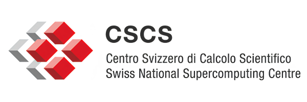
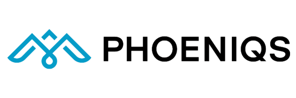
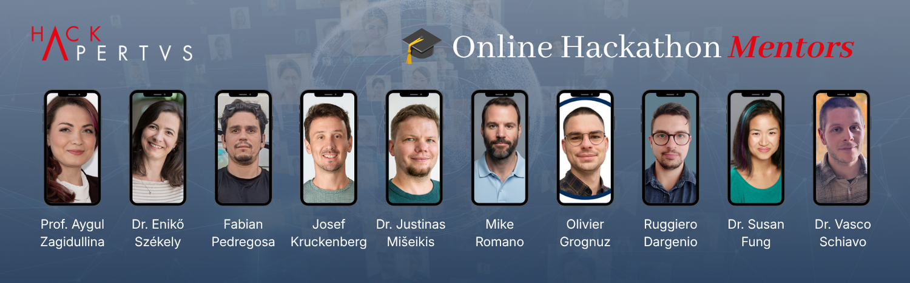

Source URL: https://hackapertus.notion.site/0e9b4fec112a8380989881f264af0895
Fetch date: 2026-10-12

# Resources & Tools

### 👉🏼 This page will be fully released on October 1st, 12:00.
We can't answer any questions in the meantime. Thanks for your understanding.

Our partners PHOENIQS, CSCS, Hugging Face, and Edit with Ava support you with several tools and credits. To apply for the resources, please use the **same email address** as your Devpost account. Otherwise, we can't provide access or codes.

#### **→ Resources**

##### **1) Inference support:**

size: 53 KiB

**CSCS** supports all Hack teams by providing access via API.
**Update 6.10.26, 18:40 CEST**: Available keys have been distributed. We are no longer accepting new requests.
**
2) Compute support:**

a) If you are a student at one of these academic partner institutions, contact your professor to get signed up: BFH, FHGR, FHNW, HSLU, OST, SUPSI, UZH, ZHAW
For the sign-up you'll need your institutional email address and an ID card or passport.

size: 23.7 KiB

b) All others hackers may apply for support from our partner **Phoeniqs**. 
**Update 4.10.26, 20:30 CEST**: We have received many great applications and are no longer accepting new ones.

#### **
3) Hugging Face:**

size: 36.3 KiB

Get 10$ in credits for [Inference Providers](https://huggingface.co/docs/inference-providers), [Inference Endpoints](https://huggingface.co/docs/inference-endpoints/main/en/index), [Jobs](https://huggingface.co/settings/jobs), [Spaces](https://huggingface.co/docs/hub/spaces), compute, storage, and more (subscription fees excluded).

👉🏼  Please sign-up here to get the code:
[http://hackapertus.ch/online-hack/hugging-face](http://hackapertus.ch/online-hack/hugging-face)

#### **
4) Edit with Ava:**

size: 40.4 KiB

Edit with Ava supports your creative work with free credits for videos  Use it to create a compelling video about your prototype.

Go to and find all details how to access it: [INFO PAGE](https://avlana.notion.site/Getting-Free-Credits-for-EditWithAva-3de3bdc93da0801d8934df4d9c8efd42)

#### **
→ Mentorship**

size: 951.1 KiB

Check out our amazing mentors who are happy to help you.
You can book a session online:
[https://hackapertus.notion.site/mentors](https://hackapertus.notion.site/mentors?source=copy_link)

#### **→ Supporting Materials**

**Official Apertus website incl. documentation:
**[https://www.apertus-ai.org/](https://www.apertus-ai.org/)

##### **The model**

[Apertus: Democratizing Open and Compliant LLMs](https://arxiv.org/abs/2509.14233)
The primary source: architecture (xIELU activation, AdEMAMix optimizer), the legally-compliant training-data pipeline, the "Goldfish objective" against verbatim memorization, and benchmark numbers for both sizes.

[Apertus v1](https://huggingface.co/collections/swiss-ai/apertus-v1) & [v1.5](https://huggingface.co/collections/swiss-ai/apertus-v15) model collections
The actual checkpoints. v1 (8B/70B, base + instruct) and v1.5 (multimodal, longer context).

[Data Transparency repository](https://github.com/swiss-ai/apertus-data-transparency)
Exactly what the model was trained on and how it was filtered. Useful if your project needs to reason about — or defend — data provenance.

---

##### **Examples & Demos**

[Swiss Legal RAG Demo](https://github.com/alexchilton/apertus_demo_hf)
A complete, minimal RAG app: Gradio front end, Apertus-8B via the HF Inference API, answering questions over the Swiss Federal Constitution and Data Protection Act in German, French, Italian, or English. No GPU, no vector database — deployable straight to a free HF Space. Copy this pattern for any "chat with our documents" project.

[Apertus Translate](https://github.com/swiss-ai/apertus-translate)
The core team's own experiments pushing Apertus on translation and other multilingual tasks, evaluated with both human raters and automatic metrics. A template for how to rigorously test any capability claim about the model, not only translation.

[Apertus Probe](https://github.com/swiss-ai/apertus-probes)
Trains linear probes on Apertus's internal activations to predict when it's about to hallucinate. A good starting point if your hackathon angle is interpretability rather than another chat app.

[Case study: in-house translation for Canton of Ticino](https://www.cscs.ch/science/computer-science-hpc/2026/apertus-powers-in-house-ai-translation-for-ticino)
A fine-tuned Apertus-8B now runs production translation for a Swiss cantonal government. A hint at where a public-sector framing for your project could go.

---

##### **Prompt Optimization**

[A systematic Survey of Automatic Prompt Optimization Techiniques](https://arxiv.org/abs/2502.16923)
A unifying framework and taxonomy across the field. Useful if you want to create the perfect prompt for your task.

##### **Fine-Tuning & Adaptation**

[Apertus fine-tuning recipes](https://github.com/swiss-ai/apertus-finetuning-recipes)
Pre-wired for this exact model: LoRA and full-parameter scripts, single-GPU 8B runs on a 40GB card, multi-node configs for 70B. Start here before anything generic.

[PEFT](https://huggingface.co/docs/peft/index) & [TRL](https://huggingface.co/docs/trl/sft_trainer) libraries
The actual implementations you'll import: PEFT for LoRA/DoRA/prefix/prompt tuning, TRL's SFTTrainer for turning a dataset into a fine-tuned model in a few lines of code.

[Alignment Handbook](https://github.com/huggingface/alignment-handbook)
The Alignment Handbook is a battle-tested SFT/DPO recipe template. Copy it instead of building a training pipeline from scratch.

##### 🏋🏻‍♂️ Overall Awesome Apertus overview

‣

##### **
Contributions from ****[FHNWbusiness](https://www.linkedin.com/showcase/fhnwbusiness/)**

- A Jupyter notebook for fine-tuning Apertus, tested on Kaggle and CSCS JupyterLab (Clariden):

**[https://www.kaggle.com/code/andreasmartinch/sft-apertus-v1-5-8b-hack-apertus-template](https://www.linkedin.com/safety/go/?url=https%3A%2F%2Fwww%2Ekaggle%2Ecom%2Fcode%2Fandreasmartinch%2Fsft-apertus-v1-5-8b-hack-apertus-template&urlhash=ZP6y&mt=dAN0ONYgqd6YvEYpMNw-RYGrhZqUQsO9tZa1fBOUN_eVpNI7j20sUvwikAhzXDvU-ZzVe3DZjYWduu71VMyIWYt5ZsD3NiY6injny96H9Ed7Hd9Wc9dfZUUG1f6NuNKAKY9iSL80K-PidnVUv8_PeOOGJpLgiqNHEQ&isSdui=true)**

- A text-only version of Apertus 1.5 8B that can be loaded with the standard Transformers library:

**[https://huggingface.co/andreasmartin/apertus-v1.5-8b-text](https://www.linkedin.com/safety/go/?url=https%3A%2F%2Fhuggingface%2Eco%2Fandreasmartin%2Fapertus-v1%2E5-8b-text&urlhash=eJyh&mt=wIUvrKCWzH2YApIYl-ZFet8PfYU-LGHMClD7kXl7CUb-iChFsg7NukYJg70JrGzn2HTw9aJWpCaTpiO1_KtVUED_Ol3mODyubnuFZhg34824y1lzHul_aKXn4jY6B2Yh-RsZgtyDRd5i7CKHdyXRMQfPrOuogO5KfQ&isSdui=true)**

- Experimental collection, including an embedding conversion of Apertus:

**[https://huggingface.co/collections/andreasmartin/apertus](https://www.linkedin.com/safety/go/?url=https%3A%2F%2Fhuggingface%2Eco%2Fcollections%2Fandreasmartin%2Fapertus&urlhash=GwSQ&mt=qBWOEFT0NjatanbdhDcRnWMBQpl2KZt--p9ehxRilgrzEKfRRsmNYE1dcKKHYOMXCKijs-rGA6xYO9-cY5eQDNyiWgAf-sTsPcP39jSDIa9PSNZ22QyzRT8f04ajceXXvjA8_Gs-9D4FkUpfJb_7DAkzyUJTWDmXqQ&isSdui=true)**
